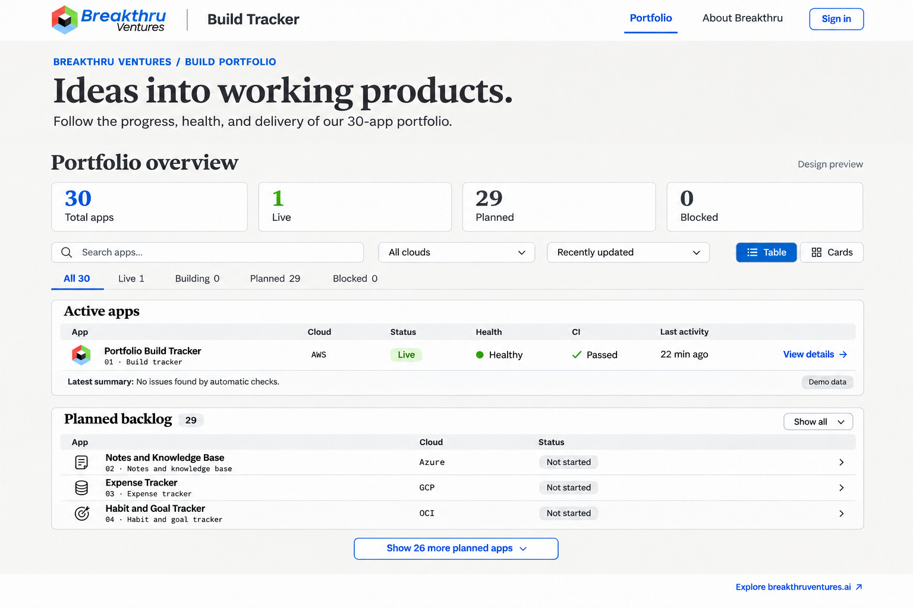

# Breakthru design system

Every app in the portfolio uses one look: the Breakthru header and footer, one font system, one set of color
tokens and a small set of shared components. This folder is the reference every agent reads before UI work.
The code lives in [`30-apps-template`](https://github.com/BreakthruDevelopment/30-apps-template), so each new
app starts with it; apps created before a template change pull it in by cherry-picking the template commit.

`portfolio-board.png` is the approved concept, drawn for app 1 (Portfolio Build Tracker). Counts and timestamps
in it are illustrative. It is a direction, not a pixel spec: pages must stay responsive and render real data.

## Where things live

| Piece | Location |
| --- | --- |
| This guide and the concept image | `ai-dev-os/design/` |
| Logos (`public/branding/`), fonts, color tokens (`src/app/globals.css`), header and footer, shared components (`src/components/ui/`) | `30-apps-template` |
| App-specific pages (for example app 1's portfolio overview) | That app's repo, built from the shared components |

## Branding

- The full Breakthru Ventures logo sits in the upper-left of the header, followed by a divider and the app's
  name (for example "Build Tracker", "Notes and Knowledge Base"). No other logo on the page: no large mark in
  the introduction and no logo in the footer.
- The footer links to https://breakthruventures.ai ("Explore breakthruventures.ai").
- Use the original logo files (`BreakthruLogo819.png`, `bvcolorlogo.jpeg`), stored in `public/branding/`.
  Never extract artwork from the concept image.
- Fonts, matching breakthruventures.ai: **Newsreader** for display headings, **Public Sans** for interface text,
  **IBM Plex Mono** for technical identifiers (app numbers, repo names, cloud names). Load them with
  `next/font/google` (self-hosted at build time; no runtime request to Google).

## Tokens

Colors come only from the tokens in `globals.css` (`bg-surface`, `text-muted`, `border-border`, `bg-accent` and
the status tokens); no raw colors in components. The palette follows the concept: white header, light-grey page,
white panels with a thin border, Breakthru blue for links and primary actions, green for live and healthy,
neutral grey for not started, amber for building or degraded, red for blocked or down. Both light and dark
themes keep these meanings.

## Shared components (template)

| Component | Use |
| --- | --- |
| `AppShell` | Header (logo, app name, nav, sign-in or user menu with sign out) and footer; every page |
| `PageIntro` | Eyebrow ("BREAKTHRU VENTURES / …"), Newsreader headline, one-line description |
| `StatTile` | A number and a label, in a responsive grid (stacks at 375px) |
| `FilterBar` | Search box, select filters, sort, and a table/cards toggle |
| `StatusBadge` | Status and health labels with the tokens above; "Not started" is neutral, never an error |
| `DataList` | A table on desktop that becomes compact cards on phones |
| `Panel` | A titled white panel, optionally collapsible ("Show all", "Show 26 more") |
| `DemoBadge` | "Demo data" label for seeded or demo-mode content; a label, not a button |

## Rules for every page

- Works at 375px wide: stacked tiles, touch targets of at least 44px, no horizontal page scroll.
- Server authorization is unchanged by styling: hidden controls are also enforced on the server.
- Show live information first; keep empty or not-yet-available data compact instead of repeating "n/a".
- Don't put `loading.tsx` or `<Suspense>` above a page that calls `requireRoleOrRedirect()` or `notFound()`:
  streaming turns their redirects and 404s into 200 responses.

## App 1 specifics (Portfolio Build Tracker)

The concept's board: introduction, totals (total, live, planned, blocked), search, cloud filter, sort, table or
cards, an "Active apps" panel with cloud, status, health, CI and last activity, the latest AI summary with its
demo badge, and a collapsed "Planned backlog". Live apps show health and build data; planned apps show only
name, number, cloud and "Not started".
